# Olist E-Commerce Analytics on AWS

An end-to-end **batch data engineering pipeline on AWS** for the Brazilian e-commerce marketplace
**Olist**. Raw order data and a daily API feed land in an S3 data lake, are cleaned and modelled
into a **galaxy schema** (3 fact tables sharing dimensions) with AWS Glue (PySpark), loaded into **Amazon Redshift Serverless**, and
analysed in **Amazon QuickSight**. The whole flow runs **automatically every night**, is
**re-run safe**, and alerts by email when something fails.

| | |
|---|---|
| **Data** | [Olist Brazilian E-Commerce dataset](https://www.kaggle.com/datasets/olistbr/brazilian-ecommerce): 9 CSV files, ~100k orders, Sep 2016 – Oct 2018 + a simulated daily API feed |
| **Cloud** | AWS `us-east-1`: S3, Glue, Athena, Lambda, Step Functions, EventBridge, Redshift Serverless, QuickSight, SNS, CloudWatch, Secrets Manager, IAM |
| **Warehouse model** | Galaxy schema (fact constellation): 3 fact tables sharing 6 dimensions, surrogate keys, "Unknown" members |
| **Schedule** | Daily at 02:00 IST, orchestrated by Step Functions |

---

## 1. Business problem

Olist connects small Brazilian sellers to large marketplaces. The business wants answers to:

1. How are **revenue and orders** growing month by month?
2. Which **product categories** and **regions** drive the business?
3. How do customers **pay**, and how many use instalments?
4. Is **delivery** on time, where is it late, and how does lateness affect **customer reviews**?

The source data is spread over 9 operational files with inconsistent types, duplicates, typos
in column names and no history of changes, so it cannot be analysed directly. This project
builds a reliable, automated warehouse that answers these questions every morning.

---

## 2. Architecture

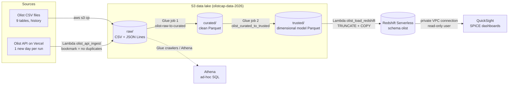

**Orchestration**, one Step Functions state machine `olistcap_pipeline`, started by an
EventBridge schedule (`olist-daily-run`, 02:00 Asia/Kolkata):

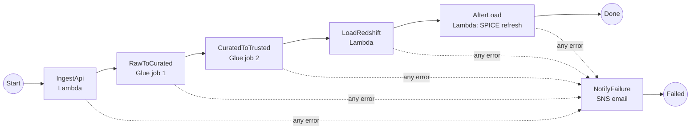

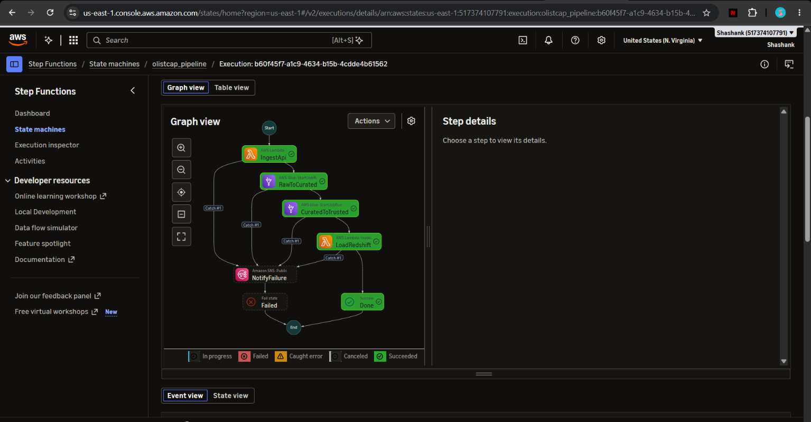

---

## 3. Data sources

| Source | What | How it arrives | Format in `raw/` |
|---|---|---|---|
| Olist history | orders, order_items, payments, reviews, customers, sellers, products, category_translation, geolocation | one-time upload (`aws_copy.sh`) | `raw/<table>/*.csv` |
| Olist API (simulated live feed) | new orders, items, payments, reviews… one business day at a time, plus the Brazilian **states** reference table | Lambda `olist_api_ingest`, every pipeline run | `raw/api_<table>/event_date=YYYY-MM-DD/events.jsonl` |
| Manual uploads | validated CSV corrections or new rows for any table | validated before they reach the lake | `raw/upload_<table>/upload_id=…/data.jsonl` |

Every row keeps a **`data_source`** column (`history` / `api` / `upload`), all the way into
Redshift, so lineage is always visible.

**Incremental ingestion without duplicates.** The API Lambda keeps a bookmark
(`s3://…/state/api_ingest_bookmark.json`) with the last day saved. Each run fetches only the
days after it, writes each day to its own `event_date=` folder (re-saving a day overwrites the
same key), and moves the bookmark forward after every day. A failed run resumes where it stopped.

---

## 4. Data lake layers

| Layer | Contents | Written by | Format |
|---|---|---|---|
| `raw/` | data exactly as received, never changed | upload / Lambda | CSV, JSON Lines |
| `curated/` | one clean table per entity, all sources combined, de-duplicated, real data types | Glue job 1 | Parquet (`orders` partitioned by `purchase_year`, `purchase_month`) |
| `trusted/` | the dimensional model (facts + dimensions), ready to load | Glue job 2 | Parquet, one file per table |
| `state/` | ingestion bookmark | Lambda | JSON |

Glue Data Catalog databases: `olist_raw_db`, `olist_curated_db`, `olist_trusted_db`, so every
layer can also be queried with **Athena**.

---

## 5. Data quality: problems found and how they were fixed

Profiling the raw files (Athena + Glue crawlers) found these issues. Glue job 1
([`glue_scripts/olist-raw-to-curated.py`](glue_scripts/olist-raw-to-curated.py)) fixes them:

| Problem found | Fix |
|---|---|
| Crawler read all-text CSVs as `col0, col1…` and kept the header as a data row | Re-created the Athena tables with `OpenCSVSerde` + `skip.header.line.count` ([`data_clean/col_issue.sql`](data_clean/col_issue.sql)) |
| Review comments contain line breaks and quotes | Read with `multiLine` + `escape '"'`; line breaks replaced by one space |
| Byte-order mark / quotes in header names | Header names stripped |
| Everything is text (dates, prices, counts) | Cast to timestamp / double / int; `"40"` and `"40.0"` both become `40` |
| Zip codes lost their leading zero (`1046`) | Left-padded back to 5 digits (`01046`) |
| Empty strings instead of nulls, extra spaces, mixed case | Trimmed; empty → null; status / city lower case; state codes upper case |
| Misspelled columns `product_name_lenght`, `product_description_lenght` | Renamed to `…_length` |
| The same order arrives again from the API with a newer status | `keep_latest`: one row per key; newer source and later status win (created < approved < invoiced < processing < shipped < delivered) |
| ~1 million GPS points, some outside Brazil | Averaged to one point per zip code, points outside Brazil ignored |
| A missing date or an unknown state | Mapped to an **Unknown** row (key `-1`) in `dim_date` / `dim_geography` instead of being dropped; facts use **left joins** so no order is lost |
| Product without a category | Category set to `unknown` |

Glue job 2 ends with a **row-count guard**: the run fails (and alerts) if `fact_orders` does not
have exactly one row per curated order, so a bad join can never silently add or lose orders.

---

## 6. Data model: galaxy schema (Redshift `olist` schema)

### Which schema type is this?
A **star schema** is **one** fact table in the middle with its dimensions around it. This model
has **3 fact tables** that **share the same dimensions**, so it is a **galaxy schema** (also called
a **fact constellation**):

| Term | Meaning | In this project |
|---|---|---|
| **Star schema** | 1 fact table + its dimensions | each fact on its own *is* a star (for example `fact_sales` + customer, seller, product, date) |
| **Galaxy schema / fact constellation** | several facts that **share conformed dimensions** | `fact_sales`, `fact_orders`, `fact_payments` all use the same `dim_customer` and `dim_date` |
| **Snowflaking** | a dimension that points to another dimension | `dim_customer` and `dim_seller` → `dim_geography` (one small snowflaked branch) |

So the precise name is a **galaxy schema with one snowflaked dimension (geography)**.

**Are the fact tables connected to each other?** Not with foreign keys. Facts never reference
other facts. All three carry **`order_id`** as a **degenerate dimension** (an id with no
dimension table of its own), so they *can* be joined on `order_id` when needed (for example,
payments vs items of the same order). Normally they are compared **through the shared
dimensions** (customer, date) instead, which is called **drill-across**.

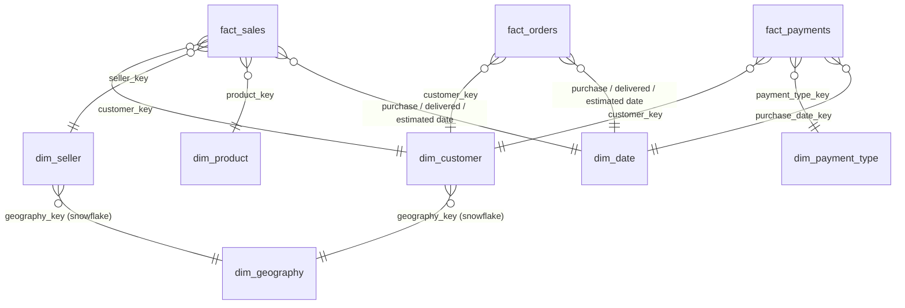

| Shared (conformed) dimension | fact_sales | fact_orders | fact_payments |
|---|:---:|:---:|:---:|
| dim_customer (→ dim_geography) | ✅ | ✅ | ✅ |
| dim_date | ✅ (3 roles) | ✅ (3 roles) | ✅ |
| dim_seller (→ dim_geography) | ✅ | | |
| dim_product | ✅ | | |
| dim_payment_type | | | ✅ |
| `order_id` (degenerate) | ✅ | ✅ | ✅ |

`dim_date` is a **role-playing dimension**: the same table is used as the purchase, delivered
and estimated delivery date.

| Table | Grain (one row = …) | Main columns |
|---|---|---|
| **fact_sales** | one **order item** | price, freight_value, item_total, order_status, 3 date keys |
| **fact_orders** | one **order** | item_count, items_value, freight_total, payment_total, max_installments, avg_review, delivery_days, delay_days, **is_late** |
| **fact_payments** | one **payment** of an order | payment_value, payment_installments |
| dim_customer | customer | city, state, zip, geography_key |
| dim_seller | seller | city, state, zip, geography_key |
| dim_product | product | category (Portuguese + English), weight, photos |
| dim_geography | Brazilian state | state name, region (from the API) |
| dim_payment_type | payment method | credit_card, boleto, voucher, debit_card |
| dim_date | calendar day from 2016 (extends automatically with the API feed) | year, quarter, month, day name, is_weekend |

**Design decisions**
- **Galaxy, not one big star: three facts, three grains.** Item-level revenue, order-level
  delivery KPIs and payment-level methods cannot share one grain without double counting
  (an order with 3 items and 2 payments would repeat values), so each gets its own fact.
- **Conformed dimensions:** customer and date are built once and shared by all facts, so
  "revenue by state" and "late % by state" always use the same definitions.
- **Geography is snowflaked** (customer and seller both point to `dim_geography`) because
  state and region come from a separate API reference table and are shared by two dimensions.
- **Surrogate keys** (`row_number`) on every dimension; `dim_date` and `dim_geography` have a
  `-1` **Unknown** row, so orders with a missing date or state still join and are counted.
- **`is_late` and `delivery_days` are computed in the fact**, once, instead of in every dashboard.
- Order totals are **aggregated before joining** (items, payments, reviews per order) to avoid
  fan-out double counting.
- Redshift: facts use `DISTKEY(order_id)` and `SORTKEY(purchase_date_key)`; small dimensions
  use `DISTSTYLE ALL`. A materialized view `mv_monthly_sales` serves the monthly trend.
- Load = `TRUNCATE` + `COPY … FORMAT AS PARQUET` for every table, so a re-run always gives the
  same result (**idempotent**).

DDL: [`redshift/table_creation.sql`](redshift/table_creation.sql) · analysis SQL:
[`redshift/queries.sql`](redshift/queries.sql)

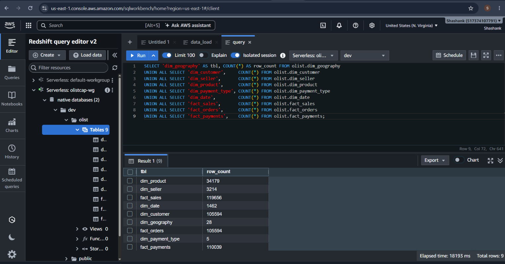

---

## 7. Proof of work (screenshots from the AWS account)

Every stage of the pipeline was built and run in a real AWS account (`us-east-1`).
Click an image to open it full size.

### 7.1 S3 data lake: one bucket, separate layers
The bucket `olistcap-data-2026` holds the `raw/`, `curated/` and `trusted/` layers, plus `state/`
(ingestion bookmark), `scripts/`, `temp/` and `athena-results/`.

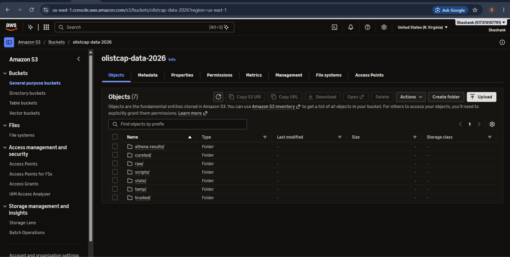

<table>
<tr>
<td align="center"><b>raw/</b>: data as received<br>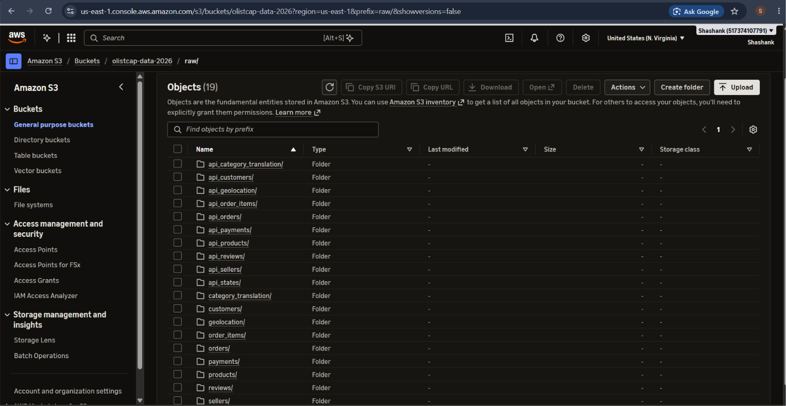</td>
<td align="center"><b>curated/</b>: cleaned Parquet<br>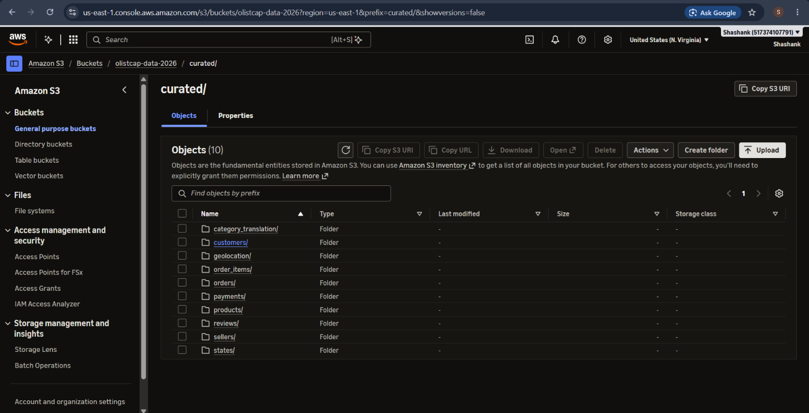</td>
<td align="center"><b>trusted/</b>: facts and dimensions<br>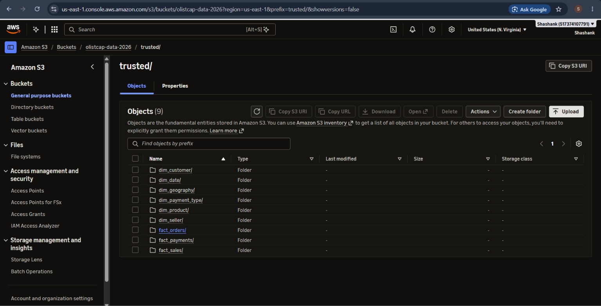</td>
</tr>
</table>

### 7.2 AWS Glue: ETL jobs and Data Catalog
The two Glue ETL jobs (script mode): `olist-raw-to-curated` (job 1, cleaning) and
`olist_curated_to_trusted` (job 2, dimensional model).

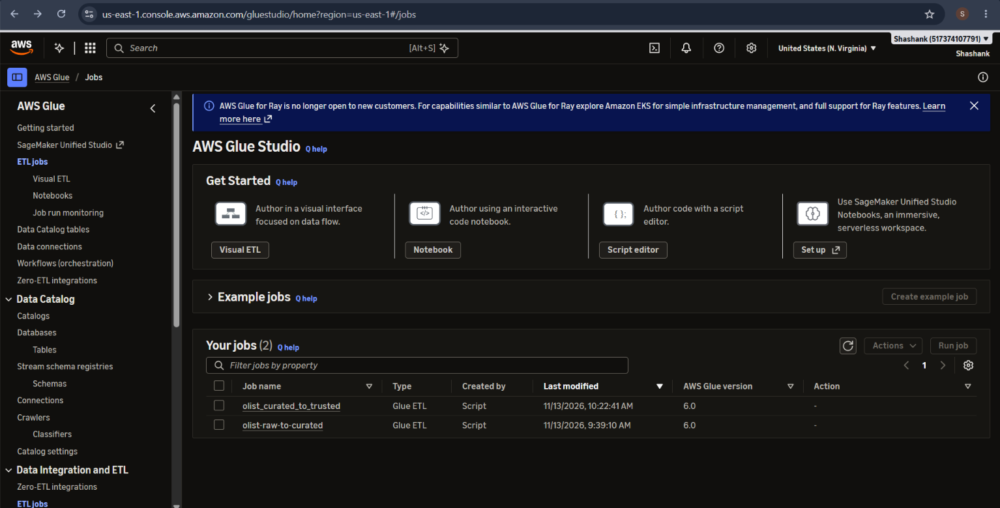

The trusted layer registered in the Glue Data Catalog (`olist_trusted_db`): 6 dimension and
3 fact tables in Parquet, queryable with Athena.

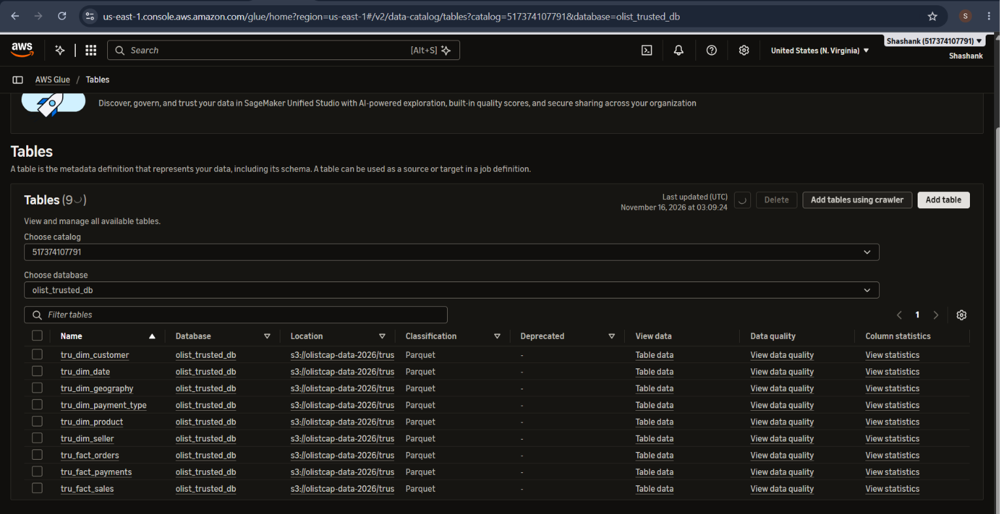

### 7.3 Step Functions: the automated pipeline run
A successful run of `olistcap_pipeline`: IngestApi → RawToCurated → CuratedToTrusted →
LoadRedshift → Done, each step with a Catch to the SNS failure alert.


### 7.4 Redshift Serverless: the loaded warehouse
Row counts of all 9 tables in the `olist` schema after a load (for example, fact_sales
119,656 item rows, fact_orders 105,594 orders).


Sample rows of every table (Redshift Query Editor v2). In `fact_orders`, an order that was
never delivered has `delivered_date_key = -1`, the **Unknown** date member, so it is still counted.

<table>
<tr>
<td align="center"><b>dim_customer</b><br>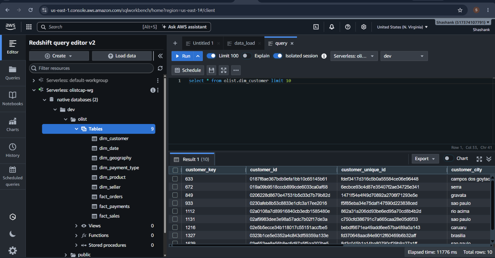</td>
<td align="center"><b>dim_seller</b><br>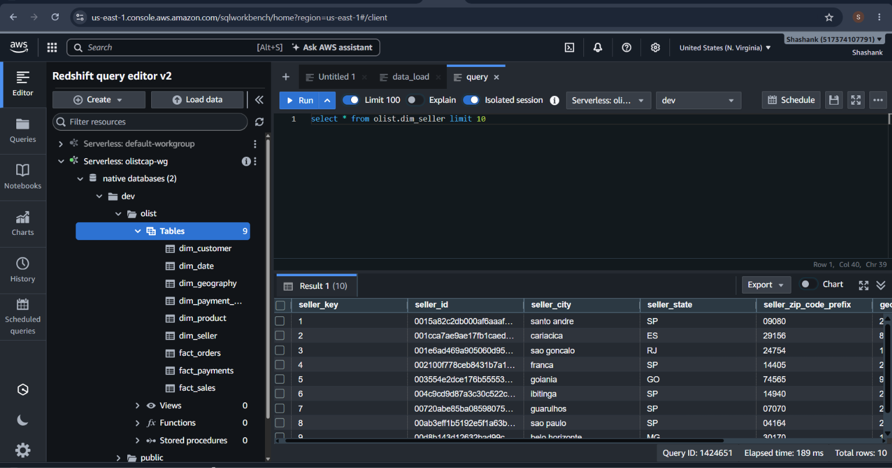</td>
<td align="center"><b>dim_product</b><br>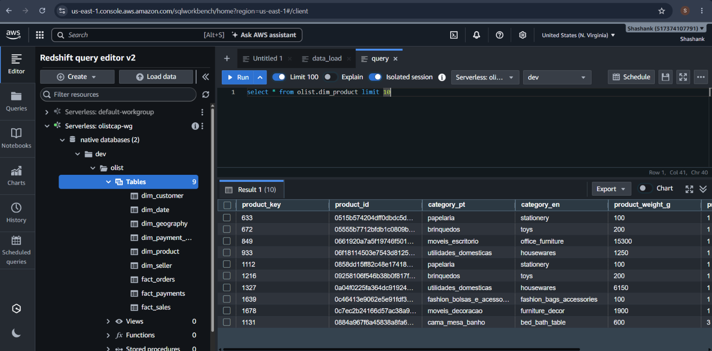</td>
</tr>
<tr>
<td align="center"><b>dim_geography</b><br>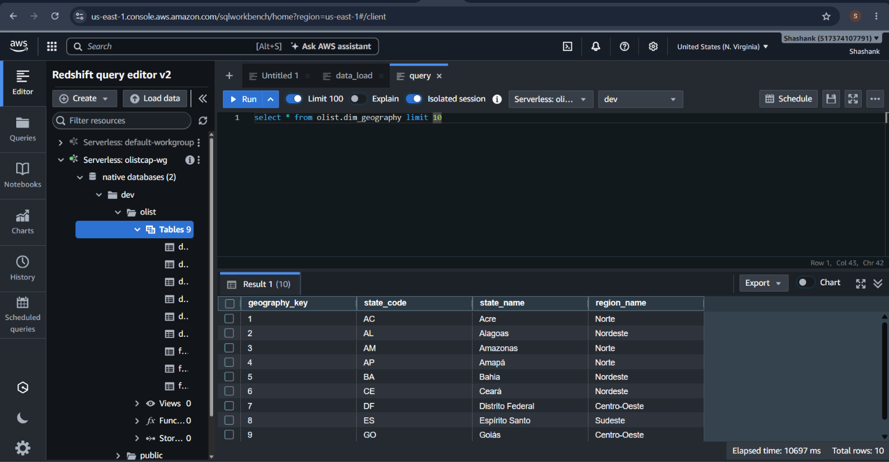</td>
<td align="center"><b>dim_payment_type</b><br>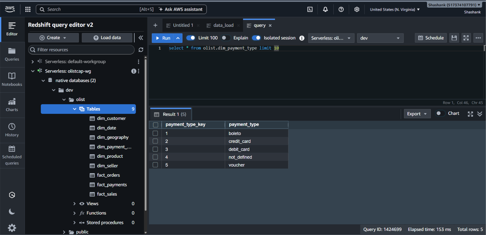</td>
<td align="center"><b>dim_date</b><br>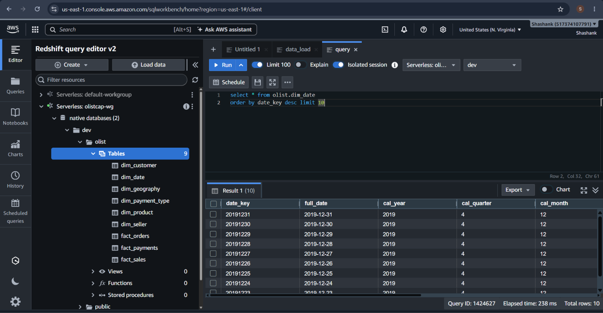</td>
</tr>
<tr>
<td align="center"><b>fact_sales</b><br>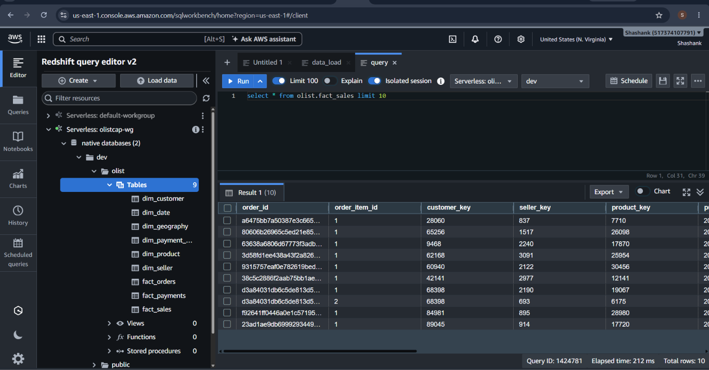</td>
<td align="center"><b>fact_orders</b><br>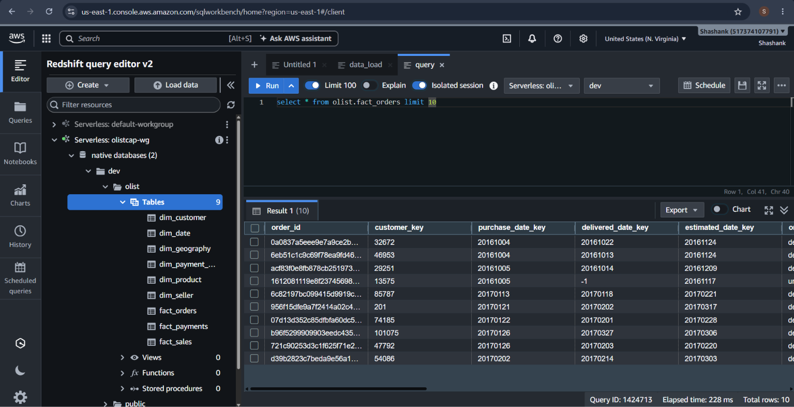</td>
<td align="center"><b>fact_payments</b><br>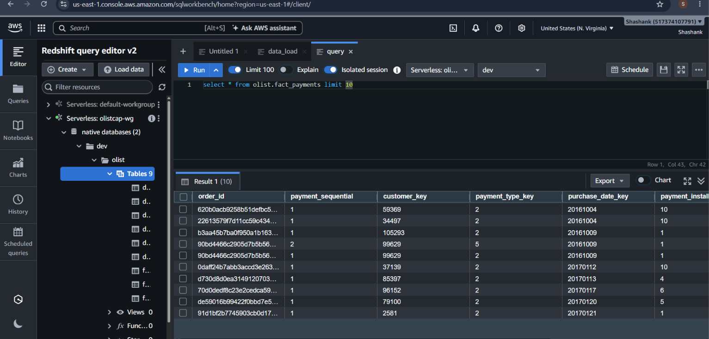</td>
</tr>
</table>

### 7.5 Data model diagram
An interactive diagram of the trusted model with its surrogate keys:
[`docs/evidence/olist_trusted_erd_surrogate_keys.html`](docs/evidence/olist_trusted_erd_surrogate_keys.html)
(download and open it in a browser).

### 7.6 QuickSight dashboards
[`analysic/Olist_Sales_Dashboard.pdf`](analysic/Olist_Sales_Dashboard.pdf) (sales trends,
categories, payments) and [`analysic/Olist_map_dashboard.pdf`](analysic/Olist_map_dashboard.pdf)
(orders and late deliveries by state).

---

## 8. Business insights

Computed from the Olist history (Sep 2016 – Oct 2018: 99,441 orders, 112,650 items,
96,096 unique customers, 3,095 sellers, 32,951 products). Values in Brazilian Real (R$).

### Growth
- **Product revenue R$ 13.59 M** (+ R$ 2.25 M freight); **average order value R$ 137.75**.
- **Strong growth:** Jan–Aug 2018 revenue (R$ 7.39 M) is **2.4×** Jan–Aug 2017 (R$ 3.11 M).
- **Peak month: November 2017** (R$ 1.01 M, Black Friday). 2018 then stays near R$ 1 M per month.

### What sells
| Category | Revenue | Share |
|---|---|---|
| health_beauty | R$ 1.26 M | 9.3 % |
| watches_gifts | R$ 1.21 M | 8.9 % |
| bed_bath_table | R$ 1.04 M | 7.6 % |
| sports_leisure | R$ 0.99 M | 7.3 % |
| computers_accessories | R$ 0.91 M | 6.7 % |

The top 5 categories bring only ~40 % of revenue: the catalogue is **broad, not
concentrated**, so growth depends on many sellers rather than a few hits.

### Where customers are
- **São Paulo (SP) alone places 42 % of all orders**; SP + RJ + MG = **66.6 %**.
- The South-East is the core market; the North and North-East are small but growing.

### How they pay
- **Credit card: 73.9 % of payments, 78.3 % of value.** Boleto (bank slip) 19 %, voucher 5.6 %,
  debit card 1.5 %.
- **67 % of card payments use instalments** (average 3.5): buying in parts is normal in Brazil,
  so instalment-friendly pricing matters.

### Delivery and customer satisfaction (the strongest insight)
- Average delivery time is **12.5 days**; **6.8 % of delivered orders arrive late**.
- Lateness is **regional**: **Alagoas 21.4 %**, Maranhão 17.4 %, Sergipe 15.2 %, Piauí 13.9 %
  late, vs **São Paulo 4.5 %**.
- **Late delivery destroys satisfaction:** average review **2.27 / 5 when late vs 4.29 when on
  time**, and **53.7 % of late orders get a 1-star review** (vs 6.6 % on time).
- Overall reviews are good (average 4.09; 57.8 % five-star), so **delivery is the main lever**
  for the remaining unhappy customers.

### Loyalty
- Only **3.1 % of customers order more than once**. The marketplace grows by acquiring new
  buyers, not by retention.

### Recommendations
1. **Fix logistics in the North-East first** (AL, MA, SE, PI): regional carriers or local
   stock, plus realistic estimated delivery dates there. This is the biggest driver of 1-star reviews.
2. **Plan capacity for November** (Black Friday), the yearly peak.
3. **Launch a retention programme** (vouchers after the first order, email follow-ups):
   with 97 % one-time buyers, even small repeat-rate gains add revenue cheaply.
4. **Keep instalment options** and promote them in the top categories.

Dashboards: [`analysic/Olist_Sales_Dashboard.pdf`](analysic/Olist_Sales_Dashboard.pdf),
[`analysic/Olist_map_dashboard.pdf`](analysic/Olist_map_dashboard.pdf).

---

## 9. Security

- **A separate IAM role per component** (Glue, each Lambda, Redshift COPY, QuickSight VPC),
  each scoped to the bucket paths, secrets and services it needs.
- **Redshift is private.** QuickSight reaches it through a **QuickSight VPC connection**,
  never over the public internet.
- BI tools use a **read-only database user** (`quicksight_ro`, SELECT only).
- **Passwords live in AWS Secrets Manager**, never in code or in this repository.
- The S3 bucket is not public; S3 encrypts objects at rest by default (SSE-S3).

## 10. Monitoring and operations

- Every pipeline step has a **Catch** → **SNS email** (`olist-alerts`) with the error.
- **CloudWatch alarm** `olist-pipeline-failed` on the state machine's `ExecutionsFailed` metric.
- QuickSight **SPICE** is refreshed right after each load (AfterLoad step) and on a daily
  04:00 schedule as a backup.
- Re-running the pipeline is always safe: bookmark + overwrite in ingestion, `keep_latest` in
  Glue, full rebuild of curated/trusted, `TRUNCATE` + `COPY` in Redshift.

## 11. Cost notes

- Redshift **Serverless** (pay per use, scales to zero) instead of an always-on cluster.
- Parquet + partitioning keep Glue, Athena and Redshift scans small.
- QuickSight **SPICE** import: Redshift is queried once per refresh, not on every dashboard click.
- Small Glue jobs with `spark.sql.shuffle.partitions = 8` instead of the default 200.

---

## 12. Repository structure

```
├── aws_copy.sh                       # upload the 9 CSVs to raw/ + create Glue databases
├── aws_pipeline_step_function.json   # Step Functions definition (olistcap_pipeline)
├── lambda/
│   ├── api_ingestion.py              # olist_api_ingest: incremental API -> raw/ (bookmark)
│   └── load_redshift.py              # olist_load_redshift: TRUNCATE + COPY, refresh MV
├── glue_scripts/
│   ├── olist-raw-to-curated.py       # Glue job 1: combine, clean, de-duplicate -> curated/
│   └── olist_curated_to_trusted.py   # Glue job 2: facts + dimensions -> trusted/
├── redshift/
│   ├── table_creation.sql            # fact and dimension DDL
│   ├── data_copy.sql                 # COPY commands
│   └── queries.sql                   # business analysis queries
├── data_clean/col_issue.sql          # Athena fix for the crawler header problem
├── analysic/                         # QuickSight dashboard exports (PDF)
└── docs/evidence/                    # screenshots: S3 layers, Glue, Redshift tables, pipeline
```

The raw dataset is not stored here (it is large). Download it from
[Kaggle](https://www.kaggle.com/datasets/olistbr/brazilian-ecommerce) into `data/`.

## 13. How to run it

1. Create the S3 bucket and run [`aws_copy.sh`](aws_copy.sh) (upload CSVs, create Glue databases).
2. Create the Glue jobs from [`glue_scripts/`](glue_scripts/) (Glue 4.0/5.0, role with S3 access).
3. Create Redshift Serverless (namespace + workgroup), run
   [`redshift/table_creation.sql`](redshift/table_creation.sql).
4. Deploy the Lambdas from [`lambda/`](lambda/) with their environment variables (see each file's header).
5. Create the state machine from
   [`aws_pipeline_step_function.json`](aws_pipeline_step_function.json) and an EventBridge schedule for it.
6. Connect QuickSight to Redshift (VPC connection, read-only user) and build the dashboards.

## 14. Challenges and lessons learned

- **Glue crawler header problem:** all-text CSVs were read as `col0…` with the header as data;
  fixed with explicit Athena DDL and `OpenCSVSerde`.
- **Duplicates from the API:** solved at three levels: ingestion bookmark, overwrite per day,
  and `keep_latest` with a status ranking in Glue.
- **Fan-out double counting** when joining items and payments to orders: fixed by aggregating
  child tables per order before the join.
- **Missing dimension members:** left joins plus an Unknown `-1` row (date, geography) keep
  every order in the facts instead of silently dropping rows.

## 15. Future improvements

- Incremental (merge) loads into Redshift instead of a full reload, once data grows.
- **AWS Glue Data Quality** rulesets with a pass/fail score per run.
- SCD Type 2 on customers and sellers to keep address history.
- Natural-language questions on the warehouse with **Amazon Bedrock** (text-to-SQL).

---

## 16. Contributors

<table>
  <tr>
    <td align="center" width="220">
      <a href="https://github.com/Gurumurthys1">
        <br>
        <b>Gurumurthy S</b>
      </a><br>
      <sub>Data pipeline design · AWS Glue ETL · Redshift data model · automation</sub>
    </td>
    <td align="center" width="220">
      <a href="https://github.com/Kannan-S-coder">
        <br>
        <b>Kannan S</b>
      </a><br>
      <sub>AWS Glue ETL ·Redshift data model.  QuickSight dashboards · Documentation</sub>
    </td>
  </tr>
</table>
